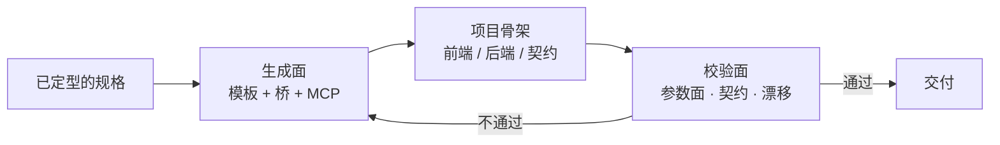

# AI Foundation

一套围绕「**已定型的规格 → 项目骨架**」构建的 AI 工程体系，核心命题是：**用可机器判定的约束层，抬高 AI 生成代码的质量下限。**

AI 写代码的能力上限由模型决定，下限却由工程底座决定。这个系列把模板、契约、参数面与校验串成一条链，让 AI 在骨架里填充业务，而不是从零即兴发挥。

> 本仓是系列的**元信息与决策记录中心**。实际代码分散在下列各仓。

## 设计心智：规范驱动开发（SDD）

- **规范是唯一真源**，AI 从规范产出实现（代码 / 真协议 / 页面）
- **底座抬下限**：模板提供机制与接缝，契约锁定前后端对齐，校验兜底
- **只做能被机器判定的那一段**：生成可校验、契约可校验、漂移可校验 → 进系列；需求取舍与设计判断 → 留在人与对话中

## 架构

## 仓库地图

| 仓库 | 角色 |
| --- | --- |
| [ai-foundation-memory](https://github.com/jianghua-developer/ai-foundation-memory) | 系列元信息与决策记录（本仓） |
| [fullstack-bridge](https://github.com/jianghua-developer/fullstack-bridge) | 前后端连通层：多单元组合的治理与生成 CLI |
| [bridge-mcp-server](https://github.com/jianghua-developer/bridge-mcp-server) | 桥的能力层：以 MCP 暴露生成面 |
| [python-fastapi-template](https://github.com/jianghua-developer/python-fastapi-template) | 后端底座（Python / FastAPI） |
| [vite-react-spa-template](https://github.com/jianghua-developer/vite-react-spa-template) | 前端底座（React） |
| [vite-vue-spa-template](https://github.com/jianghua-developer/vite-vue-spa-template) | 前端底座（Vue） |
| [fullstack-param-protocol](https://github.com/jianghua-developer/fullstack-param-protocol) | 底座与桥的参数面对齐协议 |
| [ai-foundation-review](https://github.com/jianghua-developer/ai-foundation-review) | 跨仓评审报告归档 |
| [ai-foundation-spec-chain](https://github.com/jianghua-developer/ai-foundation-spec-chain) | 上游规格链（已停止，保留负结果档案） |
| [frontend-template-copier](https://github.com/jianghua-developer/frontend-template-copier) | 前端模板生成器（已退役） |

## 几个关键机制

**① params.json 对齐协议**
每个底座通过 copier 内省生成 `params.json`，自描述参数面（含派生参数与禁用选项）。桥零注册直读，CI 校验 `params.json` 与 `copier.yml` 一致，参数变化时向桥发漂移信号。

**② copier 模板 + 契约模板**
前端、后端、契约全部用 copier 渲染，按参数条件裁剪代码与章节，保证"生成出来的形态"与"契约描述的形态"严格一致。全链 copier 钉同一版本。

**③ 双路径**
- 单端：底座自述参数面，不经过桥
- 多端（N≥2）：注册组合，通过桥生成，契约由桥统一提供

**④ 机器校验兜底**
协议一致性、契约覆盖、版本漂移全部进 CI；不通过则阻断合并，而不是靠人记。

## 状态

**2026-09-15 系列收手**：不再开新方向，聚焦底座开发与自我验证（dogfood）。

收手前的判断与负结果都完整保留下来，作为"这一层该做到哪"的经验：

- [系列总览 / 当前状态](series-overview.md)
- [边界收窄决议：为什么只做「已定型规格 → 骨架」](direction-scope-narrowing.md)
- [上游规格链的负结果档案](direction-spec-chain.md)（及其 [评估报告](https://github.com/jianghua-developer/ai-foundation-spec-chain/blob/main/docs/EVALUATION.md)）

## 从这里开始

- 想了解全局：读 [series-overview.md](series-overview.md)
- 想了解为什么这样划线：读 [direction-scope-narrowing.md](direction-scope-narrowing.md)
- 想看具体实现：进 [fullstack-bridge](https://github.com/jianghua-developer/fullstack-bridge) 与各底座仓

---

个人研究项目。文档记录了设计取舍与证伪过程，欢迎参考，也欢迎指出其中站不住脚的地方。
